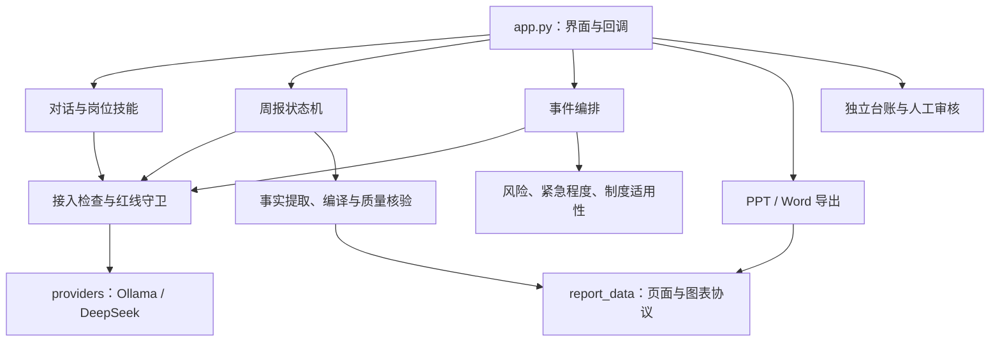

# LUX 项目功能梳理与安全整合报告

分析日期：2026-10-26。依据：用户上传的 `1LUX_work-now(1).zip` 实际代码、配置和测试；不以历史版本说明代替当前实现。

## 1. 结论与本次范围

LUX 当前是面向安保办公的 **Gradio + Python 单机/局域网应用**。主界面有 9 个一级页签，岗位助手有 11 个技能。事件处置、周报交付、奖惩参考、安全审核分别构成业务链路；它们共享模型、安全和基础存储能力，但不能按名称相似直接合并。

本次完成代码整合：将周报页面/图表数据协议提取到 `core/report_data.py`，将 3 处正文过滤收敛为一个带兼容参数的实现，将 3 处模型消息组装收敛为一个函数。原有导入入口、页面事件、业务状态、权限、数据库结构、制度内容均保留。同步修正 README 中与实际包内容不符的描述。

验证结果：原版 **213/213** 测试通过；修改后 **228/228** 测试通过（新增 15 项）；**4,074** 个解析/校验对比案例零差异。结果支持本次变更的兼容性，不代表所有真实模型输出和 Windows Office 环境均已验证。

原始 ZIP 未被覆盖。提供干净源码与覆盖包，不包含原包 `.env`、账号数据库、业务数据库、日志、历史下载文件、虚拟环境或 Git 历史。现有电脑上的配置和业务数据应保留。

## 2. 功能地图、入口与边界

| 功能域 / 当前页签 | 用户能力 | 主要入口 | 核心模块与边界 |
|---|---|---|---|
| 智能工作台 | 流式对话、岗位技能、最近有效对话上下文、文件/图片附件、结果验收 | `respond`、`enter_skill`、`ingest_attachment`、`save_acceptance_feedback` | `skills`、`chat_context`、`ingest`、`redline_guard`、`providers`；历史只选有效问答，统一进入安全检查 |
| 智能工作台 / 邮件 | 当前结果填入邮件、格式整理、内容指纹确认后发送 | `fill_last_reply`、`apply_format`、`do_send_email` | `mailer`、权限检查；收件人/抄送/主题/正文变更后需重新确认 |
| 交付中心 / 周报 | 素材事实提取、语义分析、页面策划、事实编译、来源与内容质量核验、预览 | `_structure_ppt_source`、`stream_structure_ppt_source_ui`、`refresh_weekly_preview` | `weekly_report_engine` 调度，`weekly_report_agent` 承担事实/质量规则；本地页面骨架与模型策划策略保留 |
| 交付中心 / PPT | 动态页数创作、参考主题、原页内容填充、可编辑图表、QA 与逐页预览 | `export_ppt_workspace`、`inspect_delivery_template` | `ppt_export`、`ppt_template`、`ppt_pipeline`、新增 `report_data`；原页替换需模板页数相符，参考创作可重建页面 |
| 交付中心 / Word、PDF | 周报 Word 输出、Word→PDF、本用户交付版本记录 | `export_word_workspace`、`run_word_pdf`、`render_recent_deliverables` | `build_weekly_docx`、`word_pdf`、`deliverable_store`；PDF 转换依赖 Windows Word，旧 `.doc` 在转换前被拒绝 |
| 运营管理 | 模型健康、磁盘、任务统计、近期活动与管理入口 | `render_operations` 等运行面板函数 | `health`、`task_queue`、`startup_checks`；健康检查不等于实际生成质量验证 |
| 效能看板 | 使用次数、岗位/技能统计、工时估算和反馈 | `render_dashboard_authorized`、`render_dashboard` | `db`、`task_queue`；团队查看受权限约束，估算工时不等同实际节省 |
| 事件中心 / 事件处置 | 要素补全、分类路由、风险/紧急程度、制度依据、处置建议与报告草案 | `run_agent_task` | `orchestrator` → `workflow` → `supervisor` → 具体 Agent；生成建议后停在人工确认 |
| 事件中心 / 事件闭环 | 待确认、处置中、待补充、结案；责任人、时限、人工操作留痕 | `render_incident_cases`、`transition_incident_case` | `incident_store` 与 `task_queue`；现场事件结案必须区别于 AI 任务生成完成 |
| 事件中心 / 奖惩参考 | 本地规则检索、候选条款/原文链接、自动记录匹配结果 | `run_reward_penalty_match`、`render_reward_penalty_records` | `reward_penalty_engine`、`reward_penalty_store`、`policy_source_links`；仅候选参考，不自动处分或确定罚金 |
| 资源中心 | 部门提示词查询、载入、创建、删除 | `refresh_lib`、`load_prompt`、`save_prompt`、`delete_prompt` | `PromptDB`；可维护模板与内置岗位技能来源不同，管理操作受权限约束 |
| 安全治理 | 受控文件审核列表、原件访问、人工决定 | 审核页回调，见 `MODULE_INDEX.json` | `review_queue`、`auth`、`region_policy`；审核队列保存受控原件，不能并入只存元数据的任务表 |
| 任务历史 | 当前用户/授权范围的任务查询、分页、状态和评价 | 任务历史页回调，见 `MODULE_INDEX.json` | `task_queue`；保存元数据、摘要、状态和反馈，不用于恢复完整聊天正文 |
| 账号管理 | 个人账号、新增/重置密码/停用、角色控制、登录锁定 | 账号管理页；`manage_users.py` | `auth.UserStore`；PBKDF2 密码哈希，operator/reviewer/supervisor/admin 四类角色 |

上述函数未注明模块时均在 `app.py`；完整函数、类方法、行号及静态导入记录在 `docs/MODULE_INDEX.json`，便于定位而不依赖本报告的概括。

### 11 个岗位技能

| 岗位 | 当前技能 | 合并判断 |
|---|---|---|
| 管理岗 | H区周报（动态创作）、通知/通报撰写、数据Key Message分析 | 共用技能加载机制；保留不同文稿契约 |
| 巡逻岗 | 巡检记录整理、异常整改上报 | 巡检归档与异常上报目的不同 |
| 门禁岗 | 门禁异常情况说明、进出登记汇总 | 叙事说明与台账计数不能合为同一提示词 |
| 监控岗 | 监控异常日报、违禁品台账汇总 | 日报结构与查获统计口径不同 |
| NPI管控 | NPI管控日报、NPI进出登记汇总 | 可在后续将通用写作约束抽成公共文本，但区域、物料和岗位要求应保留 |

### 运行与实验入口

- `install.ps1`：Windows 环境安装；`start_web.ps1`：加载环境配置、检查/启动 Ollama、运行 `app.py`；`service.ps1`：服务相关运行管理。
- `app.py`：实际 Gradio 网页入口。界面样式由 `core/ui_theme.py` 加载 `frontend/lux.css`。
- `healthcheck.py` / `healthcheck.ps1`：健康检查；`manage_users.py`：命令行账号维护。
- `demo.py` / `run.ps1`：红线演示，配置密钥时可调用 DeepSeek；`demo_agent.py`：编排演示。它们不是主界面运行入口。
- `voice_test.py`、`voice_live_test.py`、`voice_asr.py`：独立语音实验，分别使用音频文件和流式片段；主界面语音按钮隐藏且未开放。依赖 `faster_whisper`，实时实验另用 NumPy/SciPy；主 requirements 未完整声明这些实验依赖。
- `frontend/HcopilotAurora.jsx`：设计原型，当前 Python 页面未引用，不是第二套已上线前端。
- `docs/archive/`：历史版本说明，应作为历史资料阅读。

## 3. 分层职责与依赖



| 层级 | 文件 / 模块 | 主要责任 |
|---|---|---|
| 配置和展示 | `settings`、`skills`、`ui_labels`、`ui_theme` | 环境配置、岗位任务定义、边界文案、统一样式加载 |
| 模型和上下文 | `providers`、`chat_context` | 提供方协议、流式/非流式、视觉请求、有效历史与预算 |
| 安全接入 | `ingest`、`file_reader`、`ocr`、`image_classifier`、`redline_guard`、`region_policy` | 文件元数据先验、读取/OCR、区域规则、风险初筛、输入/输出检查与脱敏 |
| 认证和审核 | `auth`、`startup_checks`、`review_queue` | 个人账号、角色、登录保护、启动条件及受控原件审核 |
| 事件编排 | `orchestrator`、`supervisor`、`workflow`、`agents/*` | 构造依赖、关键词路由、阶段控制、巡检/事件处理、风险与紧急程度、报告草案、否定语境 |
| 制度和奖惩 | `policy_engine`、`reward_penalty_engine`、`policy_source_links`、`incident_response_config` | 条件式制度匹配、专项奖惩检索、来源链接、响应配置；不是一个可互换算法 |
| 周报内容 | `weekly_report_engine`、`weekly_report_agent` | 状态机、有限重试、事实/来源、页面编译、内容核验、Word 输出 |
| 周报格式和渲染 | **`report_data`**、`ppt_export`、`ppt_template`、`ppt_pipeline`、`ppt_preview.ps1` | 共享纯解析；动态版面/模板策略；图表绘制/字体/QA；独立 PowerPoint 预览 |
| 文档和外发 | `word_pdf`、`mailer` | Office 转换、邮件格式和 SMTP 传输，授权由调用方控制 |
| 存储和运行 | `db`、`task_queue`、`incident_store`、`reward_penalty_store`、`deliverable_store`、`sqlite_util`、`health`、`audit/audit_logger` | 分域持久化、统一 SQLite 连接、运行健康和审计 |

主要外部依赖：Gradio 6.28.x、python-docx、python-pptx、openpyxl、Pillow；Windows 条件依赖 winocr、pywin32。Ollama/DeepSeek 为模型服务；Windows Word/PowerPoint 为 Office 能力。各项启用条件不同，不能因对话可用就判断 OCR、PDF、预览均可用。

重构前，周报内容模块通过 `ppt_export` 获取页面解析，解析又依赖 `ppt_pipeline` 的图表校验；预览/导出从 `ppt_template` 私有函数获取图表数据。重构后这些消费者直接使用纯 Python `report_data`。模板渲染与 QA 仍有形状操作的相互引用，本次没有声称消除了全部循环依赖。

### 数据边界

| 数据 | 存储 | 为什么不合并 |
|---|---|---|
| 提示词及使用统计 | `prompts.db` | 可复用业务资源及统计 |
| AI 任务及反馈 | `tasks.db` | 生成任务生命周期，不等于现场结案 |
| 事件与人工决定 | `incidents.db` 中事件相关表 | 现场处置状态、责任与决定 |
| 奖惩参考记录 | 同一 `incidents.db` 的 `reward_penalty_records` | 保存脱敏描述及匹配结果，字段和保留口径不同 |
| 交付文件版本 | `deliverables.db` | 文件路径、摘要、版本及归属 |
| 受控原件审核 | `reviews.db` 与审核文件目录 | 保存原件并需限定审核访问 |
| 账号 | `users.json` | 哈希密码和角色，不应作为一般业务数据处理 |
| 审计 | 日志文件 | 元数据/摘要日志，不替代业务台账 |

`sqlite_util.connect_db` 已统一 WAL、busy_timeout、Row 工厂、提交和关闭。重复的几行连接包装属于清晰的领域接口，不再为减少行数强行引入通用 ORM。

## 4. 重复项与合并依据

| 重复或重叠项 | 处理 | 依据与保留差异 |
|---|---|---|
| PPT/模板/质量检查的正文数据块过滤 | **已合并** | 3 个循环变为 `visible_body`；模板保留英文标签支持，原长度检查保留 JSON 计入文本的行为 |
| 页面解析、标题正文分离、图表验证/解析分散在渲染模块 | **已集中** | 迁移 10 个纯函数至 `report_data`；原模块保留兼容导入，数据协议不再依赖 Office 渲染对象 |
| Ollama、DeepSeek、Ollama 流式的 messages 组装 | **已合并** | `_chat_messages` 统一 system→user 顺序；各提供方鉴权、token 参数、JSON 参数、错误与流式语义不变 |
| 新建 PPT、主题参考、原页填充 | **保留策略** | 新建/参考要重建页面；原页填充保留模板对象与布局，不能简单删除一个分支 |
| 事实核验的数据块过滤 `_without_data_blocks` | **保留独立** | 属于安全/事实核验，其 JSON、空行与恢复规则不等同显示过滤；避免重构改变拦截范围 |
| 风险等级与紧急程度 | **必须分开** | 一个评估潜在后果，一个评估现场响应，工作流和台账同时使用 |
| 制度匹配与奖惩匹配 | **保留算法，建议后续统一来源模型** | 前者检查事实、适用条件、缺失信息；后者按对象和行为相似性检索条款，规则字段和完备性不同 |
| 图片、普通文档、Word 转换闸门 | **保留分支** | 已复用 `_precheck`，Word 转换已复用 `ingest_document`；图片另有 OCR/视觉/资产分类，Word 有 50MB 与旧格式限制 |
| 内置岗位技能与部门提示词库 | **保留双来源** | 前者是代码/模板定义任务契约，后者是可编辑共享资源；可统一展示，不宜混为同一可随意修改实体 |
| 任务台账、事件台账、审核和交付台账 | **保留领域边界** | 数据内容、权限、生命周期不同，已有共用连接设施 |
| 旧聊天 PPT 导出函数 | **保留兼容，列为待退役** | 当前界面绑定交付中心，但无法证明外部脚本无人调用；旧返回格式、路径和检查流程不同 |
| 静态 JSX 与 Gradio | **保留原型** | JSX 是设计参考，不是可直接替换的重复运行实现 |

本次没有调整匹配阈值、风险词表、制度条文、页面模式、角色权限、保留数据策略或数据库结构；这些变化需要独立业务验收，不能伪装成等价重构。

## 5. 实际修改文件

| 文件 | 修改内容 |
|---|---|
| `core/report_data.py`（新增） | 10 个既有纯解析/校验函数集中维护；新增统一正文过滤，保留差异参数 |
| `core/ppt_export.py` | 解析函数兼容导入；正文过滤委托共享实现；图表解析直接依赖协议模块 |
| `core/ppt_template.py` | 图表解析和正则常量兼容导入；模板正文过滤委托共享实现 |
| `core/ppt_pipeline.py` | 共享图表校验/JSON 操作改用协议模块；渲染和 QA 职责保留 |
| `core/weekly_report_agent.py` | 页面/图表解析改用协议模块；长度检查采用共享过滤但保留旧 JSON 行为 |
| `core/providers.py` | 三处消息列表组装抽成 `_chat_messages` |
| `app.py` | 仅调整预览中的图表解析导入来源，页面回调和界面不变 |
| `tests/test_shared_report_data.py`（新增） | 15 项兼容性与请求契约回归测试 |
| `scripts/verify_refactor_compat.py`（新增） | 独立进程比较两个源码目录的 4,074 个确定性案例 |
| `README.md` | 加入报告入口，修正制度原文已存在、双规则库现状及周报重试说明 |
| `文件校验.json` | 更新原有清单中修改文件的 SHA-256，不扩大原清单含义 |
| `docs/LUX_REFACTOR_REPORT.md`、`docs/MODULE_INDEX.json` | 中文分析报告与静态函数/依赖索引 |

## 6. 验证结果与复现

| 检查 | 结果 | 范围 |
|---|---|---|
| 原版 unittest discover | 213 项通过，0 失败/错误 | 先在独立目录跑原代码，建立基线 |
| 修改版 unittest discover | 228 项通过，0 失败/错误 | 原 213 项 + 新 15 项；没有删除或修改原测试来制造通过 |
| 前后结果对比 | 4,074 项一致，0 差异 | 中文/英文数据块、空行、页面边界、异常格式、图表、JSON、页码/标题等；比较结果及异常类型/消息 |
| Python 编译 | 通过 | 主入口、核心、Agent、测试和脚本的语法检查 |
| 交付文件校验 | 附清单 | 补丁可在原版本源码上还原本次修改；交付文件 SHA-256 校验 |

测试环境：Linux / Python 3.12，Gradio 6.28.0、python-docx 1.2.0、python-pptx 1.0.2、openpyxl 3.1.5、Pillow 12.3.0。测试所需环境另安装 socksio 以适配执行环境代理，未加入项目依赖。

测试使用隔离工作目录及临时测试数据；未加载用户原 `.env`，未在用户原业务数据库运行测试。`LUX_SKIP_PPT_PREVIEW=1` 关闭实际 PowerPoint 预览，`GRADIO_ANALYTICS_ENABLED=False` 关闭 Gradio 统计。

Windows 复现（项目根目录）：

```powershell
$env:LUX_SKIP_PPT_PREVIEW = "1"
$env:GRADIO_ANALYTICS_ENABLED = "False"
.\.venv\Scripts\python.exe -m unittest discover -v
.\.venv\Scripts\python.exe -m compileall -q core agents audit tests scripts app.py
# 可选：保留原版源码时，比较原版与当前目录
.\.venv\Scripts\python.exe scripts\verify_refactor_compat.py "D:\path\LUX-original" "."
```

实际 Ollama/DeepSeek 生成质量、SMTP 投递、Windows OCR、Word COM 转换、PowerPoint 截图、真实浏览器布局和并发多用户访问，本次均未完成端到端验证。已有测试中的 mock 或平台分支测试不等同这些真实服务已通过。

## 7. 待处理问题（未夹带进本次重构）

| 优先级 | 证据与问题 | 建议及验收标准 |
|---|---|---|
| P1 | 两份制度 PDF 已存在；`knowledge/policies` 两份 JSON 仍各 0 条且标记待导入，奖惩库却有 146 条 | 先核对受控版本，建立共同来源/页码/版本模型，再补齐条件式条款；用同一事件测试两个入口，解释差异，不能直接复制候选结果作为适用性判定 |
| P1 | `_current_user` 缺失/未知请求回退为 system；`_has_permission` 对 system 返回 True，与“不可提权”注释不一致 | 单独审查 Gradio 请求注入、匿名/API 调用边界；新增匿名、未知、停用账号和各角色的授权测试，再决定改为失败拒绝。本次未验证可被外部绕过，不把代码疑点写成已证实漏洞 |
| P1 | `demo_agent.py` 传入 `configured_llm`，但未将 `settings.is_external_model` 传给编排器；编排器默认 external=False | 单独修正演示与生产配置边界，验证外网模式脱敏一致性；这是行为修复，不在等价重构中静默改变 |
| P2 | `app.py` 约 3,792 行，模块导入时初始化存储并构建 UI | 按交付、事件、管理拆分服务层及 UI 装配；先保留 callback facade，建立可注入 app factory，避免测试导入产生状态 |
| P2 | 旧 `export_ppt*` 函数仍使用固定下载文件名，未采用交付中心全部检查；当前 UI 未见其绑定 | 确认外部调用后标记弃用或转发统一服务；多用户覆盖、检查差异应明确处理，不能直接删函数 |
| P2 | `start_web.ps1` 检查固定 localhost:11434，未使用可配置 `OLLAMA_URL` | 统一启动与运行配置，测试自定义端口/远程服务；避免改配置后健康检查与实际请求目标不一致 |
| P2 | JSON/英文数据块在不同显示或检查入口的规则有历史差异 | 本次为兼容保留；后续制定格式版本，在真实样例上统一，否则可能把数据算作正文长度 |
| P2 | 原包包含虚拟环境、业务数据、日志、`.env` 和 Git 历史；`.gitignore` 未完整覆盖账号/审核原件 | 建立源码发布清单，分别管理部署、数据备份与迁移；本次干净交付不包含这些运行文件 |
| P3 | 语音仍为独立实验，主依赖未完整声明，文件转写和实时转写参数不同 | 分离可选依赖，补录音设备/重采样/长时内存测试后再接入主界面，不把按钮改为可用就称为完成集成 |
| P3 | 历史架构/模板文档与当前实现部分口径不一致 | 本报告及源码作为本次快照依据；按版本继续整理旧文档，不批量删除历史记录 |

## 8. 使用交付包与回滚

交付 ZIP 内包含：

- `source/`：完整干净源码，保留配置模板、样式、制度 PDF、测试和运行脚本。
- `overlay/`：仅本次新增/修改的文件，可覆盖到**该上传版本**的项目根目录。
- `changes.patch`：标准文本补丁，便于代码审阅；与 overlay 二选一应用，不要重复应用。
- `LUX_REFACTOR_REPORT.md`：本报告；`evidence/`：原版/修改版测试日志、差异对比结果、编译与打包验证信息。
- `MANIFEST.sha256`：交付内容校验；`APPLY.md`：应用和回滚说明。

先备份现有项目并停止应用，再将 `overlay/` 内文件按相对路径覆盖。保留现有 `.env`、`.venv`、`data/`、日志和下载目录，不用干净源码覆盖/删除业务数据。若本地代码已比上传版本更新，先查看补丁并人工合并。本次无数据库迁移，回滚只需恢复备份中的旧代码并移除本次新增文件；测试和报告文件的保留不影响业务运行。
